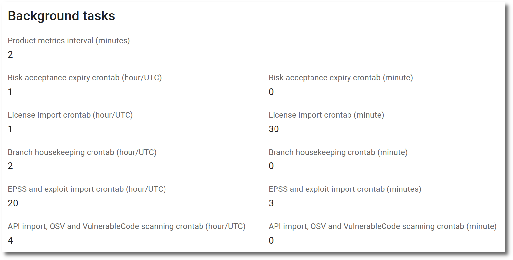

# Vulnerability scanning from OSV

The components of a product can be scanned for vulnerabilities using the OSV database. The OSV database is a database of open-source vulnerabilities, maintained by Google and is available at [https://osv.dev/](https://osv.dev/).

There are 2 preconditions for a product to be met before using the OSV database for vulnerability scanning:

* License/Component information has to be imported, only then all components are available for scanning.
* The flag `OSV scanning enabled` in the product settings has to be activated.

OSV delivers vulnerabilities for a component, without regard to the version of the component, plus a list of affected versions. Currently these package managers are supported directly to get the affected versions, by using information from the PURL of the component:

* **bitnami:** Bitnami
* **conan:** ConanCenter
* **cran:** CRAN
* **cargo:** crates.io
* **golang:** Go
* **hackage:** Hackage
* **hex:** Hex
* **maven:** Maven
* **npm:** npm
* **nuget:** NuGet
* **pub:** Pub
* **pypi:** PyPI
* **gem:** RubyGems
* **swift:** SwiftURL

Some Linux distribution and version can be determined automatically by information from the PURL of the component:

* Alpine
* Chainguard
* Debian
* Ubuntu (only the free version, not Pro)
* Wolfi

To correctly identify other Linux packages, the Linux distribution and version has to be set in the product or branch settings according to [OSV affected package specification](https://ossf.github.io/osv-schema/#affectedpackage-field). If it is not set for a branch, the product settings are used. Examples are:

| Linux distribution | Version   |
|--------------------|-----------|
| Red Hat            | rhel_aus:8.4::appstream |
| Ubuntu             | Pro:24.04:LTS |

## Manual scan

If both preconditions are met, the OSV scan can be started manually from the `Import` menu. If a branch is selected, the scan will be performed on the components of the branch. If no branch is selected, the scan will be performed on the components of all branches and components without a branch.

{ width="40%" style="display: block; margin: 0 auto" }

## Automatic scan

OSV scanning can be configured to run automatically at a specific time. There is a general setting and a setting per API configuration.

#### General setting

In the `Features` section of the [Settings](../getting_started/configuration.md#administration-in-secobserve) the automatic OSV scanning can be enabled or disabled for the whole SecObserve instance.

{ width="65%" style="display: block; margin: 0 auto" }

The hour (in UTC, unless [`TIME_ZONE`](../getting_started/configuration.md#time-zone-of-the-background-tasks) is set) and minute, when the automatic [API imports](./api_import.md/#automatic-import) and OSV scanning will run, can be set in the `Background tasks` section. A restart of the SecObserve instance is required to apply the changes.

{ width="70%" style="display: block; margin: 0 auto" }

#### Setting per product

Only products that have `Automatic OSV scanning enabled` turned on will be imported automatically.

#### Execution

The automatic scan enqueues a separate background task for each product. These tasks have a lower priority than all other background tasks, so that for example notifications don't wait until all products have been scanned. If the background process is restarted during the scans, only the scans running at that moment are lost, the remaining products are still scanned. Scans that are still queued 20 hours after they have been enqueued are dropped, so that they don't pile up with the scans of the next night.

A scan that fails with a transient error, like an outage of `api.osv.dev` or a lost database connection, is retried, see `OSV_SCAN_RETRIES` and `OSV_SCAN_RETRY_DELAY` in the [configuration](../getting_started/configuration.md#backend).

When all scans of a run have finished, the entry `Scan products with OSV` in the `Background tasks` administration shows the result, e.g. `Scanned 998 of 1000 products, 2 failed.`, and one [exception notification](./notifications.md#notifications-for-exceptions) lists the products whose last attempt has failed. If scans were lost because the background process stopped, the next run adds an entry that the previous run did not finish and sends an exception notification.

As long as the scans of a run are not finished, at most 20 hours, a manually started import doesn't enqueue the products again, so that no product is scanned twice at the same time.
