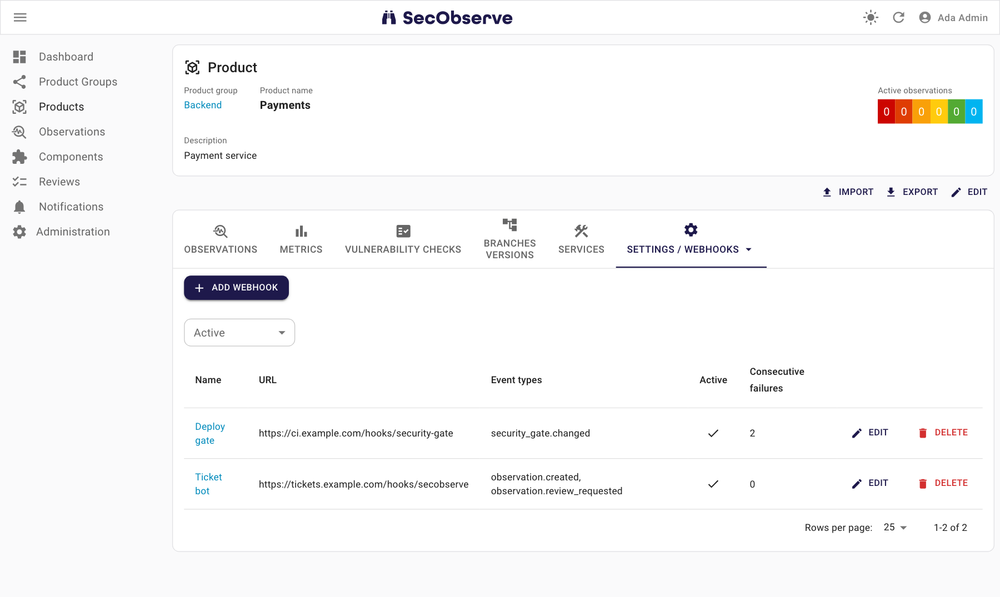
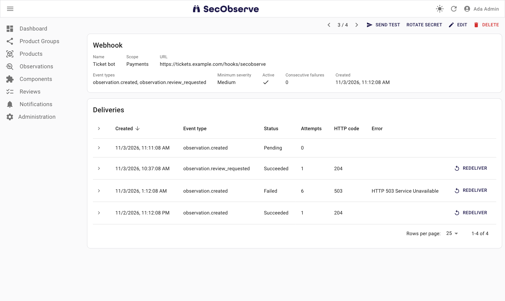

# Outbound webhooks

Webhooks send SecObserve events to your own HTTP endpoints, to drive automation: open a ticket for a new observation, ask the approvers of an assessment in a chat, or stop a deployment when the security gate fails.
The requests are signed JSON following [Standard Webhooks](https://www.standardwebhooks.com/), so libraries for many languages can verify them.
Messages for MS Teams, Slack and email are described in [Notification channels](notifications.md).

## Set up a webhook

The webhooks of a product are in **Settings → Webhooks** of the product, those of a product group in its **Webhooks** tab.
Global webhooks, which get the events of all products, are in **Administration → Webhooks**.



1. Click **Add webhook**, enter a name and the URL of your receiver, and choose the event types. A minimum severity limits the observation and assessment events.
2. Copy the secret from the dialog that follows. It is shown only once, **Rotate secret** creates a new one.
3. Store the secret in your receiver, open the webhook by clicking its name and click **Send test**.

The page of a webhook, opened by clicking its name, lists its deliveries with status, attempts and HTTP code. Click a delivery to see its payload, **Redeliver** sends it again.



Who can manage a webhook depends on its scope:

| Scope | Receives the events of | Managed by |
|---|---|---|
| Product | the product | Maintainer and Owner of the product |
| Product group | all products of the group | Maintainer and Owner of the product group |
| Global | all products, and general rules | Superusers |

Readers and Writers can view the webhooks of their products.

> **Webhook URLs are visible to all members**
>
> Every member of a product can list its webhooks with their URLs, even with the role Upload. Do not put credentials into webhook URLs, the signature authenticates the requests.

Webhooks and deliveries can also be managed with the [REST API](rest_api.md), see `/api/webhooks/` and `/api/webhook_deliveries/` in its OpenAPI documentation.

## Events

| Event type | Sent when | `data` contains |
|---|---|---|
| `observation.created` | An import or a user creates an observation that is active after rules and VEX statements. | `product`, `observation` |
| `observation.review_requested` | An observation gets the status "In review". | `product`, `observation` |
| `assessment.approval_requested` | An assessment needs approval. | `product`, `observation`, `assessment` |
| `assessment.approval_decided` | An assessment is approved or rejected, see `assessment.assessment_status`. | `product`, `observation`, `assessment` |
| `rule.approval_requested` | A rule needs approval. | `product`, `rule` |
| `rule.approval_decided` | A rule is approved or rejected, see `rule.approval_status`. | `product`, `rule` |
| `import.completed` | An import of observations has finished: file upload, API import, OSV or VulnerableCode scan. | `product`, `import` with the numbers of new, updated and resolved observations |
| `security_gate.changed` | The security gate of the product changed between passed, failed and not evaluated. | `product`, whose `security_gate_passed` is the new state |

General rules belong to no product: `product` is `null` and only global webhooks get their events.
A test request has the type `webhook.test`.

Every request has the same envelope, for example:

```json
{
  "type": "observation.created",
  "timestamp": "2026-11-02T08:15:30.123456+00:00",
  "data": {
    "product": {
      "id": 7,
      "name": "Payments",
      "product_group": {"id": 2, "name": "Backend"},
      "security_gate_passed": true,
      "url": "https://secobserve.example.com/#/products/7/show"
    },
    "observation": {
      "id": 1234,
      "title": "Prototype pollution in lodash",
      "severity": "High",
      "status": "Open",
      "priority": null,
      "vulnerability_id": "CVE-2021-23337",
      "component": "lodash:4.17.15",
      "branch": "main",
      "service": null,
      "scanner": "Trivy",
      "url": "https://secobserve.example.com/#/observations/1234/show"
    }
  }
}
```

The delivery log of a webhook keeps the exact payload of every event.
Fields are only ever added, never renamed or removed.

> **Untrusted data**
>
> Titles, component names and comments come from scanners and users. Treat them as data, never as code or commands.

## Verify requests

Each delivery is a `POST` with these headers:

| Header | Value |
|---|---|
| `webhook-id` | ID of the event, the same on every retry. |
| `webhook-timestamp` | Time of the attempt in Unix seconds. |
| `webhook-signature` | `v1,` and the base64 encoded HMAC-SHA256 of `{webhook-id}.{webhook-timestamp}.{body}`. The key is the base64 decoded part of the secret after `whsec_`. |

A [Standard Webhooks](https://www.standardwebhooks.com/) library verifies these headers, or check them yourself, for example in Python:

```python
import base64, hashlib, hmac, time

def verify(secret: str, headers, body: bytes) -> bool:
    try:
        key = base64.b64decode(secret.removeprefix("whsec_"))
        msg_id, timestamp = headers["webhook-id"], headers["webhook-timestamp"]
        if abs(time.time() - int(timestamp)) > 300:
            return False
    except (KeyError, ValueError):
        return False
    signed = f"{msg_id}.{timestamp}.".encode() + body
    expected = "v1," + base64.b64encode(hmac.new(key, signed, hashlib.sha256).digest()).decode()
    return any(hmac.compare_digest(expected, s) for s in headers.get("webhook-signature", "").split())
```

A good receiver verifies the raw body before parsing it, ignores a `webhook-id` it has already processed, and answers with a 2xx within `WEBHOOK_TIMEOUT` (10 seconds by default) before doing the actual work.

## Delivery

* A webhook is called about 2 seconds after the change, at the latest after about a minute.
* Delivery is at least once and the order is not guaranteed. Use `webhook-id` to drop duplicates, and read the current state from the REST API when the order matters.
* A failed request is retried after 1 minute, 5 minutes, 30 minutes, 2 hours and 6 hours. Meanwhile the webhook sends nothing else, so an unreachable receiver costs one request per retry. A response other than 2xx, `408`, `429` or `5xx` is not retried.
* After 5 failures in a row one alert goes to the exception notification channels of the [Settings](../getting_started/configuration.md#administration-in-secobserve). Failed deliveries can be redelivered.
* Deliveries are kept for 30 days, also those that could not be sent.
* The background tasks send the deliveries, they need to be running.

## Configuration

The `WEBHOOK_*` [environment variables](../getting_started/configuration.md#backend) change the timeout, the retry delays, the alert threshold and how long deliveries are kept.

Webhook URLs need `https` and a public address.
To reach a receiver inside your network, add its network to `WEBHOOK_ALLOWED_NETWORKS`, such a receiver may also use `http`.
Keep these networks as small as possible: every Maintainer of a product can send requests into them.

When the receiver has a certificate of an internal CA, set `REQUESTS_CA_BUNDLE` to a CA bundle that contains it.

Retries and alerts count per webhook. Prefer one global or product group webhook per receiver to many product webhooks with the same URL.
