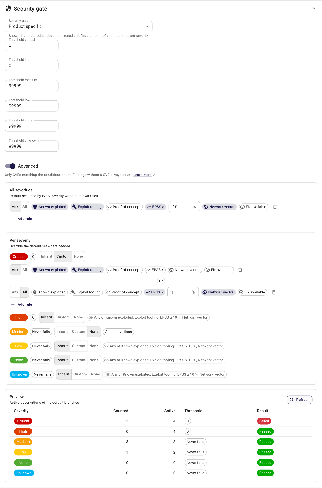
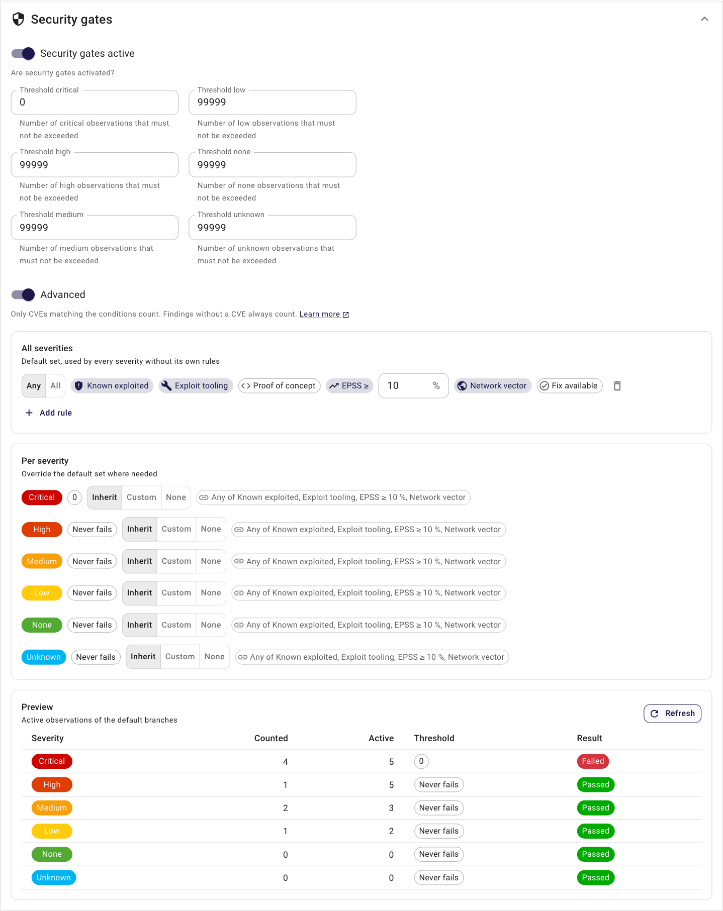
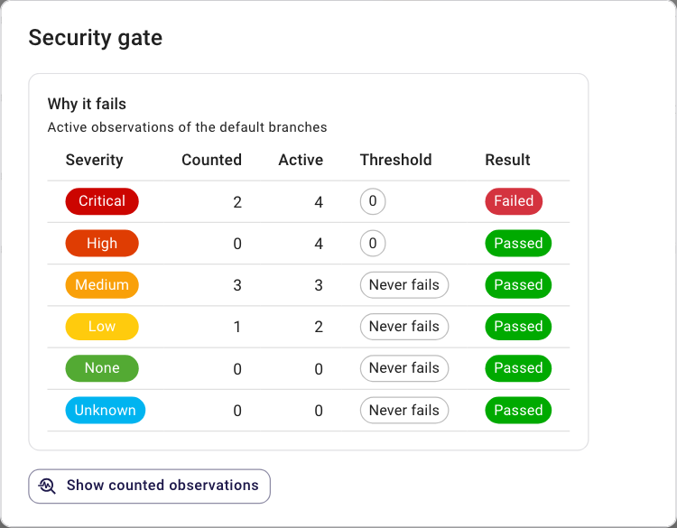

# Security gates

A security gate shows, that a product does not exceed a defined amount of vulnerabilities per severity. It can be `Passed` if the product is under or at the defined thresholds or `Failed` if the product has more observations for at least one severity.


There is an instance-wide definition of the thresholds, that can be changed by an administrator. The default is:

| Severity | Threshold |
|----------|:---------:|
| Critical | 0         |
| High     | 0         |
| Medium   | 99999     |
| Low      | 99999     |
| None     | 99999     |
| Unknown   | 99999     |

A product can decide how to deal with security gates by setting the `Security gate` attribute:

* **Standard**: Use the instance-wide definition, this is the default.
* **Disabled**: Do not calculate and show a security gate.
* **Product specific**: Use product specific thresholds to calculate the security gate.


## Advanced security gate

With **Advanced** switched on, each severity counts only the observations with a CVE that match its rules, so a finding without an exploit signal does not fail the gate.
Observations without a CVE, such as secrets, static analysis or infrastructure findings, always count.

| Condition | Matches when |
|---|---|
| Known exploited | the CVE is in the CISA KEV or VulnCheck KEV catalogue |
| Exploit tooling | an exploit exists in Metasploit, Nuclei or Exploit-DB |
| Proof of concept | a proof of concept is published on GitHub |
| EPSS ≥ | the EPSS score in percent is at or above the value |
| Network vector | the CVSS vector has network access, no privileges and no user interaction |
| Fix available | a fixed version exists |

A rule selects conditions and matches with **any** of them or **all** of them; several rules in one set are combined with or.
**All severities** is the default set; a severity can inherit it, carry its own rules, or have no conditions and count everything.
A rule needs at least one condition, and Advanced needs at least one rule.



Exploit data and EPSS scores come from the [exploit information](../integrations/exploit_information.md) and [EPSS](../integrations/epss.md) imports, which run once a day, and the security gates with rules are recalculated right after that import.
The preview shows, per severity, how many active observations on the default branch would count with the rules in the form, and the observation list can be filtered by **Counted by security gate**.
The settings are inherited the same way as the thresholds: instance settings, product group, product.



**Known exploited**, **Exploit tooling** and **Proof of concept** read the data of the exploit information import.
With the feature `Exploit information` switched off no CVE matches them, and CVEs older than the `Maximum age of exploit information` of the settings are not enriched, so they match only the other conditions.

The product header explains why the gate passes or fails: the counted and the active observations per severity, with a link to the counted observations.



## Branches / versions

The security gate of a product is calculated for its [default branch / version](branches.md#default-branch--version).

The same thresholds are applied to every other branch / version as well. The result is shown in the list of branches / versions of a product and is part of the branches API, so that a CI/CD pipeline can check the security gate of the branch it has just scanned:

```
GET /api/branches/?product=<product_id>&name=<branch_name>
```

The attribute `security_gate_passed` of a branch / version is `true` if it is under or at the thresholds, `false` if it exceeds at least one threshold and `null` if the security gate is disabled for the product.
